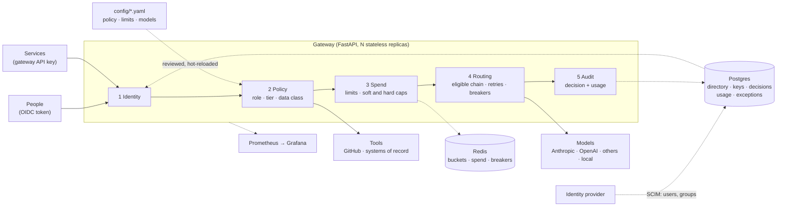

# AI Gateway

**A governed gateway for an enterprise AI platform.** Every request, from a person or a
service, to a model or a tool, passes the same five stages:
**identity → policy → spend → routing → audit.**

## The problem

When a company adopts AI, each team wires up its own access: an API key in a config file,
a model picked by whoever set it up, a tool that can read another system. That works
until someone asks the questions a regulated business has to answer:

- **Who can use this, and did the person who left last month lose access?**
- **Did confidential data go to a provider that keeps it for thirty days?**
- **Who spent $4,000, and who agreed to it?**
- **What can the assistant reach in our other systems, and with whose credentials?**
- **We changed the model on Tuesday. Does everything that depended on it still work?**
- **Can you show me, for March?**

None of these can be answered from inside one application. They need one place that every
request goes through, owned by the platform team. This is that place.

| Stage | What the gateway does |
|-------|-----------------------|
| **Identity** | People sign in through the company's identity provider (OIDC). Users and groups are provisioned over SCIM, so joiners, movers and leavers are handled where they already are. Services use gateway API keys. |
| **Policy** | A reviewed YAML file maps group → role → tier and says which model may hold which class of data, and which role may call which tool. Fail closed: no rule, no access. |
| **Spend** | Rate limits per caller, a soft cap that warns, a hard cap that refuses, and an exception queue where a second person approves more for the month. |
| **Routing** | An alias maps to a fallback chain of models. The chain is filtered to the models allowed to hold the request's data **before** routing, then retries, fallback and circuit breakers work inside what is left. |
| **Audit** | Every decision, allowed or denied, is recorded with who, what, why and the policy version. Never the content. |

Two more pieces keep it honest over time: **connectors** reach other systems with
credentials that live an hour, and an **eval gate** compares a candidate model with the
one it would replace before the switch.

## Architecture



[docs/architecture.md](docs/architecture.md) walks through each stage, where the groups
come from, what happens when a store is down, and the trust boundaries.

## Quickstart

You need Docker with Compose. No accounts and no provider keys are needed to try it.
[Ollama](https://ollama.com) is optional and gives you a free local model.

```bash
git clone https://github.com/AndrewTtofi/ai-gateway.git && cd ai-gateway
cp .env.example .env            # set GATEWAY_ADMIN_KEY (openssl rand -hex 32); provider keys are optional
ollama pull llama3.2:3b         # optional: a local model, and the only one confidential data may reach
make up                         # gateway, Redis, Postgres, Prometheus, Grafana
make key name=me tier=standard team=eng-backend   # prints a gw_… key once
export GW_KEY=gw_...
```

```bash
curl localhost:8000/v1/chat/completions -H "Authorization: Bearer $GW_KEY" \
  -H 'content-type: application/json' \
  -d '{"model":"fast","messages":[{"role":"user","content":"Say hi in five words"}]}'
```

| Service | URL |
|---------|-----|
| Gateway (API docs at `/docs`) | http://localhost:8000 |
| Grafana (admin / admin) | http://localhost:3000 |
| Prometheus | http://localhost:9090 |
| Identity provider, with `make idp` | http://localhost:9000 |

The dev stack binds every port to `127.0.0.1`.

## The 60-second demo

Four keys, four stages. [docs/demo.md](docs/demo.md) has every command with its output.

```bash
newkey() { make -s key "$@" | sed -E 's/.*"key": ?"([^"]+)".*/\1/'; }
CASE_BOT=$(newkey name=case-bot tier=standard team=compliance)
BUILD_BOT=$(newkey name=build-bot tier=standard team=eng-backend)
BATCH=$(newkey name=batch-job tier=chaos budget=0.03)
ONCALL=$(newkey name=platform-oncall tier=standard team=platform-admin)
call() { curl -s -w '  → %{http_code}\n' -H 'content-type: application/json' "$@"; }
```

**Policy.** The same tool, two roles: compliance may look up a case, engineering may not.

```bash
call localhost:8000/v1/tools/mock_records/lookup_case -H "Authorization: Bearer $CASE_BOT" -d '{"args":{"case_id":"C-1001"}}'
# {"connector":"mock_records","tool":"lookup_case","result":{"status":"open","owner":"compliance"}}  → 200
call localhost:8000/v1/tools/mock_records/lookup_case -H "Authorization: Bearer $BUILD_BOT" -d '{"args":{"case_id":"C-1001"}}'
# {"error":{…"code":"role_not_allowed"}}  → 403
```

**Data handling.** Confidential data is refused by an alias whose models all keep data.

```bash
call localhost:8000/v1/chat/completions -H "Authorization: Bearer $BUILD_BOT" -H 'x-gateway-data-class: confidential' \
  -d '{"model":"smart","messages":[{"role":"user","content":"Summarise this contract"}]}'
# {"error":{"message":"No model behind 'smart' is eligible for 'confidential' data.",…}}  → 403
```

With Ollama running, the same request to `fast` is answered by the local model, with the
two hosted models removed from the chain (`x-gateway-excluded: 2`).

**Spend.** A hard cap, then an exception that someone else has to approve.

```bash
for i in $(seq 1 12); do call -o /dev/null localhost:8000/v1/chat/completions -H "Authorization: Bearer $BATCH" \
  -d '{"model":"fake/metered","messages":[{"role":"user","content":"hello"}]}'; done | tr -d '\n→ '; echo
# 200200200200200200200200429429429429
EXC=$(call localhost:8000/v1/spend/exceptions -H "Authorization: Bearer $BATCH" \
  -d '{"amount_usd":1,"reason":"month-end batch"}' | sed -E 's/.*"id":"([^"]+)".*/\1/')
call -X POST localhost:8000/v1/spend/exceptions/$EXC/approve -H "Authorization: Bearer $BATCH"    # 403 not_an_approver
call -X POST localhost:8000/v1/spend/exceptions/$EXC/approve -H "Authorization: Bearer $ONCALL"   # 200 approved
```

**Audit.** Every step above, allowed or denied.

```bash
make decisions n=6
# 19:55:44 allow ok                 model:fake/metered            batch-job        internal
# 19:55:44 allow ok                 spend_exception:approve       platform-oncall  none
# 19:55:44 deny  not_an_approver    spend_exception:approve       batch-job        none
# 19:55:44 allow ok                 spend_exception:request       batch-job        none
# 19:55:44 deny  budget             model:fake/metered            batch-job        internal
```

**Identity**, with a real identity provider in the stack: `make idp-e2e` plays a joiner, a
mover and a leaver against authentik and checks the audit trail (about two minutes).

## What's real vs. mocked

| Part | Status |
|------|--------|
| **OIDC tokens** | **Real.** Signature, issuer, audience and expiry verified against the provider's published keys. Run end to end against authentik in CI on every pull request. |
| **SCIM provisioning** | **Real** SCIM 2.0 server, driven by authentik in CI. The request forms Okta and Entra send are covered by unit tests written from their documentation, not by a live tenant. |
| **Identity provider** | authentik, in the compose stack, instead of a hosted tenant: no account, no tunnel, testable in CI. The gateway is provider-neutral. |
| **Policy, data classes, decision log** | **Real**, enforced on every request and stored in Postgres. |
| **The data-handling rules in `config/policy.yaml`** | **Examples.** Retention terms come from your contract with each provider. |
| **Spend caps and the exception queue** | **Real.** Atomic in Redis; tested with concurrent requests and concurrent approvers. Budget amounts in `config/limits.yaml` are examples. |
| **Model calls** | **Real** adapters. Anthropic and Ollama have been run live; OpenAI, Gemini, xAI, Mistral and DeepSeek are covered by tests against recorded and mocked responses only. |
| **GitHub connector** | **Real.** A GitHub App, a signed JWT, a one-hour installation token; run against GitHub. Unit tests mock GitHub's HTTP. |
| **`mock_records` connector** | **Mocked.** A stand-in for a system of record, with one case in it, so the policy path can be shown without another system. |
| **`fake` provider and the `chaos` tier** | **Mocked**, dev stack only. Scripted failures and a priced test model for demos and load tests. Never loaded in production. |
| **Eval gate** | **Real** harness and golden tasks. Run live between two local models; not yet between hosted models. CI runs it against a deterministic stub. |
| **Benchmark numbers** | Measured on one laptop against a mock provider that replays real timing ([RESULTS.md](docs/RESULTS.md)). |

Known gaps, on purpose or not yet done:

- **The data class is declared by the caller**, not detected from content.
- **No UI.** Operators use `make` targets and the API; Grafana shows usage.
- **Approvers aren't notified** of a pending spend exception; they list the queue.
- **Decision records are never deleted automatically.** Usage rows have a retention job; decisions don't yet.
- **Tools act as the gateway's app**, not as the person asking.

## Design decisions and trade-offs

The ones worth arguing about. Each has a decision record in [docs/decisions/](docs/decisions/).

**Groups come from SCIM, not from token claims.** A token is a snapshot: put groups in it
and someone removed from a group keeps their access until it expires. The gateway uses the
token only to prove who is calling, and reads groups from a directory the identity
provider keeps current. *Trade-off:* a SCIM server to run, and a directory lookup per
request (cached for 30 seconds, invalidated on every provisioning write).
[ADR 0029](docs/decisions/0029-identity-oidc-tokens-and-scim-directory.md)

**Policy is a YAML file, not a database or a policy engine.** Access changes are pull
requests: reviewed, diffable, validated in CI against the rest of the config, and each
decision is stamped with the policy version. *Trade-off:* a change needs a merge and a
reload, not a click, and there is no per-request rule language. For a few roles and tiers
that is the right size; many teams writing their own rules would justify OPA or Cedar.
[ADR 0028](docs/decisions/0028-access-policy-data-classes-and-decision-log.md)

**Data classes filter the fallback chain inside the router.** Checking the first model
isn't enough: a fallback exists to send the request somewhere else. So ineligible models
are removed before routing, and the cache and judge follow the same ceiling.
*Trade-off:* the class is declared, not detected. Enforcement is exact; classification is
the caller's job. [ADR 0028](docs/decisions/0028-access-policy-data-classes-and-decision-log.md)

**Postgres and Redis, not SQLite.** A single file would make the quickstart smaller. But
budgets are a check-then-write that has to be atomic across replicas (a Lua script in
Redis), and the directory, the decision log and the exception queue are shared by every
replica. *Trade-off:* two services to run; in production I'd use managed ones.
[ADR 0027](docs/decisions/0027-governance-layer-on-the-routing-gateway.md)

**The hard cap stays hard; the way past it is a second person.** An approved exception
raises one caller's budget for one month, so nothing has to be undone. Grants are looked
up only after a request is refused, so everyone under budget pays nothing for the
feature. *Trade-off:* an approval takes up to ten seconds to reach other replicas.
[ADR 0032](docs/decisions/0032-soft-caps-and-spend-exceptions.md)

**Connectors hold a key, not a token.** A GitHub App's private key is traded for a
one-hour token asked for with less permission than the app has. *Trade-off:* calls are
made as the app, so every entitled caller sees the same repositories; acting as the
individual needs OAuth on their behalf. [ADR 0031](docs/decisions/0031-github-app-credentials-for-connectors.md)

**The eval gate measures regression, not a score.** A candidate fails when it loses a task
the current model passes. A task both fail is information, not a blocker. *Trade-off:* it
says nothing about absolute quality, and live runs cost money, so CI only checks the
harness. [ADR 0030](docs/decisions/0030-eval-gate-for-model-changes.md)

**A bundled identity provider instead of a hosted one.** authentik runs in the compose
stack, so the whole identity flow is tested in CI with no account or tunnel.
*Trade-off:* Okta's and Entra's behaviour is covered from their documentation, not a tenant.
[ADR 0029](docs/decisions/0029-identity-oidc-tokens-and-scim-directory.md)

**One gateway, built on a routing gateway that already worked.** Governance can't be
bolted on from outside: eligibility has to be applied where fallback happens.
*Trade-off:* a larger repository than a governance-only project.
[ADR 0027](docs/decisions/0027-governance-layer-on-the-routing-gateway.md)

**The audit log never holds content.** Who, what, when, why and under which policy; never
prompts, answers or tool arguments. *Trade-off:* it can prove a case was looked up and by
whom, not which case. That belongs in the system of record's own log.

<details>
<summary>All decision records</summary>

| ADR | Decision |
|-----|----------|
| [0001](docs/decisions/0001-config-driven-models.md) | All models are defined in config, not code |
| [0002](docs/decisions/0002-streaming-errors-and-disconnects.md) | Streaming error semantics and client disconnects |
| [0003](docs/decisions/0003-anthropic-adapter.md) | Anthropic adapter: official SDK, capabilities as config |
| [0004](docs/decisions/0004-retries-fallback-circuit-breaker.md) | Retries, fallback chains and circuit breakers |
| [0005](docs/decisions/0005-mid-stream-failure-policy.md) | No fallback after the first token |
| [0006](docs/decisions/0006-api-keys.md) | Gateway API keys: hashed, cached, stale-if-error |
| [0007](docs/decisions/0007-rate-limits-and-budgets.md) | Token-aware rate limits and budgets: estimate, then reconcile |
| [0008](docs/decisions/0008-observability.md) | Usage log, metrics with bounded labels, logs without prompts |
| [0009](docs/decisions/0009-benchmarking.md) | How the gateway is benchmarked |
| [0010](docs/decisions/0010-anthropic-messages-inbound.md) | Inbound Anthropic Messages API, translated at the edge |
| [0011](docs/decisions/0011-model-catalog-and-pricing-sync.md) | Model catalog, and price sync with review |
| [0012](docs/decisions/0012-openai-compatible-provider-rules.md) | Per-provider parameter rules for OpenAI-compatible APIs, and the `frontier` alias |
| [0013](docs/decisions/0013-lossless-anthropic-features.md) | Prompt caching and extended thinking through `/v1/messages` |
| [0014](docs/decisions/0014-openai-responses-api.md) | OpenAI Responses API adapter |
| [0015](docs/decisions/0015-cost-accuracy.md) | Long-context tiers, cache-write prices and off-peak pricing |
| [0016](docs/decisions/0016-teams-key-edits-production.md) | Teams, key edits, body limits and production packaging |
| [0017](docs/decisions/0017-policy-routing.md) | Policy routing (`model: auto`) |
| [0018](docs/decisions/0018-response-cache.md) | Response cache, exact and semantic |
| [0019](docs/decisions/0019-self-healing-alerts.md) | Self-healing: background probes, quarantine, alerts |
| [0020](docs/decisions/0020-ab-routing.md) | A/B routing with weighted, sticky variants |
| [0021](docs/decisions/0021-prompt-injection-filter.md) | Prompt-injection filter |
| [0022](docs/decisions/0022-llm-as-judge.md) | LLM-as-judge sampling |
| [0023](docs/decisions/0023-security-hardening.md) | Security hardening after the audit: billing, shared breakers, bounded requests |
| [0024](docs/decisions/0024-operational-readiness.md) | Operational readiness: alert routing, runbooks, backups, budget alerts |
| [0025](docs/decisions/0025-security-finish.md) | Pre-deploy security: image and dependency scanning, operator keys, audit log, networks |
| [0026](docs/decisions/0026-test-depth.md) | Test depth: fuzzing, golden provider fixtures, end-to-end production stack in CI |
| [0027](docs/decisions/0027-governance-layer-on-the-routing-gateway.md) | One gateway: a governance layer on the routing gateway |
| [0028](docs/decisions/0028-access-policy-data-classes-and-decision-log.md) | Access policy, data classes on the fallback chain, and the decision log |
| [0029](docs/decisions/0029-identity-oidc-tokens-and-scim-directory.md) | Identity: OIDC tokens, and groups from a SCIM-provisioned directory |
| [0030](docs/decisions/0030-eval-gate-for-model-changes.md) | An eval gate for model changes: golden tasks, regression against the current model |
| [0031](docs/decisions/0031-github-app-credentials-for-connectors.md) | Short-lived connector credentials: a GitHub App |
| [0032](docs/decisions/0032-soft-caps-and-spend-exceptions.md) | Soft caps and a spend exception queue |

</details>

## Documentation

| | |
|---|---|
| [docs/demo.md](docs/demo.md) | The demo, command by command |
| [docs/architecture.md](docs/architecture.md) | The five stages, state, trust boundaries |
| [docs/runbook.md](docs/runbook.md) | Operating it: access, policy changes, spend, connectors, secrets, audit evidence |
| [docs/enablement/](docs/enablement/README.md) | One capability explained for compliance, for the people using it, and for engineers |
| [docs/wiki/](docs/wiki/Home.md) | Every part in depth: [identity](docs/wiki/Identity.md), [governance](docs/wiki/Governance.md), [connectors](docs/wiki/Connectors.md), [limits and budgets](docs/wiki/Keys-Limits-and-Budgets.md), [model evals](docs/wiki/Model-Evals.md), routing, operations, security |

## The routing layer

Stage four is a full model gateway, built first as
[llm-gateway](https://github.com/AndrewTtofi/llm-gateway). Apps talk to one endpoint and
ask for an alias; the gateway picks the provider, falls back when one fails, and records
what the request cost. Clients use the OpenAI chat-completions format or the Anthropic
Messages API. The formats are a compatibility detail: internally every request is one
format, which is what lets a request that started on one provider fall back to another.

| Provider | How |
|----------|-----|
| **Anthropic Claude** (Opus, Sonnet, Haiku) | Native adapter on the official SDK. It translates messages, tools, streaming, usage and errors both ways. Claude is the first choice in most built-in aliases. |
| **OpenAI** | OpenAI-compatible, with per-model parameter rules |
| **Google Gemini, xAI Grok, Mistral, DeepSeek** | Their OpenAI-compatible APIs, with the parameter rules each one needs ([ADR 0012](docs/decisions/0012-openai-compatible-provider-rules.md)) |
| **Ollama** (local models, free) | Ollama's OpenAI-compatible API |
| **Any OpenAI-compatible API** (vLLM, LM Studio, OpenRouter, Together, …) | Add it in `config/models.yaml`; no code change |

OpenAI, Gemini, xAI, Mistral and DeepSeek are covered by mocked tests but haven't been run
against their live APIs yet. A provider without an API key is skipped.


```python
from openai import OpenAI   # any OpenAI SDK (or LangChain, LlamaIndex, curl, …)

client = OpenAI(base_url="http://localhost:8000/v1", api_key="gw_...")   # a gateway key
resp = client.chat.completions.create(
    model="smart",   # an alias: Claude Opus → Claude Sonnet → OpenAI, in that order
    messages=[{"role": "user", "content": "Hello"}],
    stream=True,
)
for chunk in resp:
    print(chunk.choices[0].delta.content or "", end="")
```

The client never learns which provider answered unless it reads the `x-gateway-provider` header.


<sub>Local demo traffic. The spend figures come from a fake provider priced high on purpose to exercise budgets; they are not real spend.</sub>


| | |
|---|---|
| **Routing** | Apps ask for an alias (`fast`, `smart`, `balanced`, `local`, `frontier`). `config/models.yaml` maps each alias to an ordered chain of models. To change models, edit YAML and run `make reload`; apps don't change. |
| **Smart routing** | `model: auto` builds the chain per request: the cheapest, best or fastest model that has what the request needs. Weighted, sticky **A/B variants** test a model or prompt change on part of the traffic ([guide](docs/wiki/Smart-Routing.md)). |
| **Reliability** | Transient errors are retried with jittered backoff, then the next model in the chain is tried. A circuit breaker per model, shared across replicas in Redis, stops traffic to a provider that is down. |
| **Streaming** | SSE relay. Errors before the first token can still fall back. After the first token, errors are reported in-band so a client never gets half of one answer spliced to another. When a client disconnects, the upstream request is cancelled. |
| **Limits** | Every key has requests/min, tokens/min (estimated up front, corrected to actual usage afterwards) and a monthly USD budget. Keys can belong to **teams** with their own budget. Admission is one atomic Redis Lua script, so limits hold across replicas. |
| **Cost** | Each request is priced from `config/pricing.yaml`, including cache read and write rates, long-context tiers and off-peak hours. It's written to a Postgres usage log for per-key and per-team reports. `make prices` checks prices against public catalogs, and a weekly job flags drift for review. |
| **Caching** | An optional response cache per alias, exact or semantic (embeddings + Redis vector sets), scoped per key by default ([guide](docs/wiki/Response-Cache.md)). |
| **Safety and quality** | A prompt-injection filter on user input and tool results (log, flag or block per tier), and LLM-as-judge scoring of a sample of answers ([guide](docs/wiki/Quality-and-Safety.md)). |
| **Self-healing** | Background probes recover providers without spending users' requests. Bad keys and exhausted credit quarantine a provider. Breaker changes go to a Slack-compatible webhook ([guide](docs/wiki/Self-Healing.md)). |
| **Choosing models** | `GET /v1/catalog` gives apps price, capabilities, a quality score and live latency, TTFT and error rate for every model they may use, so they can pick the cheapest or best fit ([guide](docs/wiki/Choosing-Models.md)). |
| **Observability** | Prometheus metrics (never labelled by key), a Grafana dashboard provisioned as code, SLO burn-rate alerts, and JSON logs with a request id. Prompt content is never logged. |


### Watch it fail over (no API keys needed)

The dev stack loads a `fake` provider with failure profiles. Create a key on the `chaos` tier:

```bash
make key name=demo tier=chaos   # → export GW_KEY=gw_…

# chaos-down: the primary always fails. Every request still succeeds.
curl -si localhost:8000/v1/chat/completions -H "Authorization: Bearer $GW_KEY" \
  -H 'content-type: application/json' \
  -d '{"model":"chaos-down","messages":[{"role":"user","content":"hi"}]}' | grep x-gateway
# x-gateway-provider: fake/ok
# x-gateway-fallback: true
# x-gateway-attempts: 1     ← after the first few requests: the breaker has opened,
#                              so the dead primary isn't even tried
```

The primary of `chaos-blip` is down for 20 s of every minute. Keep sending requests and
watch its breaker open, go half-open and close again on the Grafana dashboard. You can
also check breaker state directly:

```bash
curl localhost:8000/admin/providers -H "Authorization: Bearer $GATEWAY_ADMIN_KEY"
```


## Using it

### Aliases

Clients send an alias as `model`. Each alias maps to a chain of models (from `config/models.yaml`):

| Alias | Chain |
|-------|-------|
| `fast` | Claude Haiku 4.5 → OpenAI → Ollama llama3.2 |
| `smart` | Claude Opus 5.5 → Claude Sonnet 5.5 → OpenAI |
| `balanced` | Claude Sonnet 5.5 → OpenAI → Ollama llama3.2 |
| `local` | Ollama llama3.2 |
| `frontier` | The top model from each company: Claude Fable 5.1 → Claude Opus 5.5 → GPT-6 Astra → Gemini 3.1 Pro → Grok 4.7 → Mistral Medium 3.5 → DeepSeek V4.1 Flash |
| `auto` | Chosen per request: the cheapest configured model with quality ≥ 3 that can do what the request needs ([smart routing](docs/wiki/Smart-Routing.md)) |

Clients can also call an exact `provider/model` if their tier allows it. `GET /v1/models`
lists what the key may use.

### Anthropic clients (SDK, Claude Code)

`POST /v1/messages` accepts the Anthropic Messages API. Responses, streaming events and
errors come back in Anthropic's format. Authenticate with `x-api-key` or
`Authorization: Bearer`, using a gateway key.

```python
import anthropic

client = anthropic.Anthropic(base_url="http://localhost:8000", api_key="gw_...")
msg = client.messages.create(
    model="smart", max_tokens=512, messages=[{"role": "user", "content": "Hello"}]
)
```

To route Claude Code through the gateway:

```bash
export ANTHROPIC_BASE_URL=http://localhost:8000
export ANTHROPIC_AUTH_TOKEN=gw_...                 # a gateway key (see the note on tokens/min below)
export ANTHROPIC_MODEL=smart                        # gateway aliases, not Anthropic model IDs
export ANTHROPIC_DEFAULT_HAIKU_MODEL=fast
claude
```

The request is translated into the internal format, so the alias's whole fallback chain
applies, including non-Claude models.

- **Prompt caching and extended thinking** pass through to Claude targets losslessly:
  `cache_control` breakpoints, signed thinking blocks, and streamed thinking.
- **Rejected with a 400:** server tools (web search, code execution) and document blocks.

Claude Code asks for a large `max_tokens` (often 32 000) on every request. The rate limiter
reserves the prompt plus `max_tokens` up front and returns the unused part when the request
finishes, so a Claude Code key needs a tier with a tokens/min well above that, or a per-key
`tokens_per_minute` override.

`/v1/messages/count_tokens` returns the gateway's estimate, not an exact count. Each call counts
as one request against the key's limit.
[ADR 0010](docs/decisions/0010-anthropic-messages-inbound.md) has the details.

### What gets translated for Claude

The Anthropic adapter converts the following, so OpenAI-format clients can use Claude unchanged:

- **Messages:** system messages, multi-turn history, images.
- **Tools:** tool calls and tool results.
- **Parameters:** `tool_choice`, `reasoning_effort` → `effort`, and `stop`.
- **Usage:** reported in OpenAI's shape, including cached prompt tokens.
- **Responses:** finish reasons, plus error types mapped to OpenAI's error shape.

Model capabilities are flags in config rather than code. For example, newer Claude models
reject `temperature`, so the adapter drops it for them. [ADR 0003](docs/decisions/0003-anthropic-adapter.md) has the details.

### Response headers

| Header | Meaning |
|--------|---------|
| `x-gateway-provider` | Which `provider/model` served the request |
| `x-gateway-fallback` | `true` if it wasn't the chain's first choice |
| `x-gateway-attempts` | Upstream calls made, including retries |
| `x-ratelimit-*`, `retry-after` | OpenAI-style rate-limit headers |
| `x-request-id` | The gateway's id for the request, in its logs and usage row (a caller's own id comes back as `x-client-request-id`) |
| `server-timing: admit;dur=…` | Time the gateway spent on auth and limits |

Errors use OpenAI's shape (`{"error": {"message", "type", "code"}}`):

- **Over a rate limit:** `429 rate_limit_exceeded` with `retry-after`.
- **Too many requests in flight for the key:** `429 concurrency_limit_exceeded`.
- **Budget used up:** `429 insufficient_quota`.

### API keys and limits

Keys look like `gw_…`. They are shown once and stored only as a SHA-256 hash. Each key has
a tier from `config/limits.yaml`:

| Tier | Requests/min | Tokens/min | Budget/month | In flight | Aliases |
|------|-------------|-----------|--------------|-----------|---------|
| `dev` | 60 | 50 000 | $10 | 10 | `fast`, `local` |
| `standard` | 300 | 200 000 | $100 | 50 | `fast`, `balanced`, `smart`, `local`, `frontier`, `auto` |

Usage the provider bills is billed to the key too: reasoning output, and a request cut off
by a hang-up or a timeout, for at least the time the provider worked on it
([ADR 0023](docs/decisions/0023-security-hardening.md)).

Limits, budget and allowed aliases can be overridden per key:

```bash
curl -X POST localhost:8000/admin/keys -H "Authorization: Bearer $GATEWAY_ADMIN_KEY" \
  -H 'content-type: application/json' \
  -d '{"name":"batch-job","tier":"standard","tokens_per_minute":50000,"monthly_budget_usd":20}'
curl localhost:8000/admin/keys -H "Authorization: Bearer $GATEWAY_ADMIN_KEY"     # keys + spend
curl -X DELETE localhost:8000/admin/keys/<id> -H "Authorization: Bearer $GATEWAY_ADMIN_KEY"
```

### Changing models

All models, aliases, chains and prices live in `config/`. The application code contains no model names:

```yaml
# config/models.yaml
aliases:
  support-bot:   # a new alias: apps send model="support-bot"
    chain: [anthropic/claude-sonnet-5-5, openai/<model>, ollama/llama3.2:3b]
```

Run `make reload` and the change applies without a restart. [docs/CHANGING-MODELS.md](docs/CHANGING-MODELS.md)
covers adding a provider, a model or a price.

| File | Purpose |
|------|---------|
| `.env` | Secrets and service URLs (see `.env.example`) |
| `config/models.yaml` | Providers, models, capability flags, aliases, timeouts, retry and breaker settings |
| `config/pricing.yaml` | $ per 1M input / output / cached tokens per model (`make prices` to check) |
| `config/catalog.yaml` | Context window, capabilities and your quality score per model |
| `config/limits.yaml` | Rate limits, budgets and allowed aliases per tier |

## Observability

Grafana provisions the **LLM Gateway** dashboard at startup (pictured above). It shows:

- request and error rates, fallback rate by alias, and p95 latency per provider;
- time to first token, both end to end and per target;
- a circuit-breaker timeline;
- upstream attempts by outcome;
- tokens and spend per target;
- rejections by reason;
- spend per key.

The dashboard is code: edit `config/grafana/build_dashboard.py`, run it, and commit both.

- **Metrics:** `gateway_*` on an internal port (`:9100/metrics`). Labels come from bounded sets (alias, target, status, outcome, reason, …), never the API key.
- **Usage log:** the `usage_log` table has one row per request: key, alias, target, tokens, cost, latency, TTFT, attempts and status.
- **Logs:** JSON lines with `request_id`. They record prompt length, never content.
- **SLOs:** `config/prometheus-rules.yml` has multi-window burn-rate alerts on the availability error budget and a p95 TTFT alert. It also alerts on an open breaker, dropped usage rows, event-loop lag and the gateway being down.

## Results

These numbers come from one laptop and a mock provider. The mock replays measured Claude
Haiku timing. Runs are paired request by request, so the mock's own randomness cancels out.
[docs/RESULTS.md](docs/RESULTS.md) has the method, charts and raw numbers.

| | |
|---|---|
| Gateway overhead | **+2.8 ms p50 / +4.0 ms p95** per request · **+3.9 ms (0.7%)** on a realistic time to first token |
| With a 100k-character prompt | **+6.8 ms p50 / +8.2 ms p95** (estimate and injection scan included) |
| Concurrent streams, one replica (one core) | Within 10% of a direct connection up to **100** streams; at **200**, +54 ms at p95 as the core saturates |
| Throughput, 1 → 2 replicas | **417 → 551 req/s** (the test rig tops out at 899) |
| Rate-limit accuracy across 2 replicas | **−0.12%** of the configured limit |
| Budget overshoot, 50 concurrent streams | **+0.9%** (≈0.8 requests) |
| Provider outage | **3** requests went to the dead provider before the breaker opened · **0** errors reached clients |
| Provider down/slow, Redis slow/down, Postgres down | **100%** of requests served in each case (while Redis is down, rate limits are off and budgets use the last known spend; while Postgres is down, uncached keys get `503`) |
| SIGTERM with open streams | **97/97** streams completed |

Measured on the full request path: guardrails, cache lookup and atomic budget holds. That
path is about 0.2 ms heavier than v1.0's, after profiling won back most of what v1.3 had
added (4 Redis round trips per request, no timer per streamed chunk).

To reproduce:

```bash
docker compose -f docker-compose.yml -f docker-compose.bench.yml up -d --build
python tests/load/run_bench.py
python tests/load/report.py
```

## Deploying

The gateway is a stateless container. Release images for amd64 and arm64 are published to
`ghcr.io/andrewttofi/ai-gateway` on every `v*` tag, with an SBOM and signed provenance.

**On one host:** `docker-compose.prod.yml` runs the whole stack:
- Caddy with automatic TLS, with operator endpoints kept off the public site;
- two hardened gateway replicas;
- a migration job and Redis + Postgres;
- daily `usage_log` retention;
- optional Prometheus and Grafana, using a read-only database role.

```bash
cp .env.prod.example .env.prod   # fill in secrets (openssl rand -hex 32)
docker compose -f docker-compose.prod.yml --env-file .env.prod up -d
```

See [Production deployment](docs/wiki/Production-Deployment.md). Anywhere else, run as many
replicas as you need behind a load balancer, with managed Redis and Postgres:

- **Health checks:**
  - `/healthz` is the liveness check.
  - `/readyz` returns `503` until startup finishes and `200` after. It reads a status that a background task refreshes every 5 s, so a probe never waits on a hung database.
  - The `/readyz` body reports Redis and Postgres status, but their failures don't make it fail. Every replica shares those dependencies, so failing readiness would pull all replicas at once, while the gateway can serve without them.
- **Migrations:** the image's default command runs `alembic upgrade head` and then starts the server, which is fine for a single instance. With several replicas, run migrations once per deploy as a job, and start replicas with `uvicorn app.main:app --host 0.0.0.0 --port 8000 --timeout-graceful-shutdown 30`. `docker-compose.bench.yml` shows this setup.
- **Load balancer:** streams can run for minutes. Set idle and request timeouts above `stream_total` in `models.yaml`, and turn off response buffering for `text/event-stream`.
- **Shutdown:** on `SIGTERM`, uvicorn waits up to `--timeout-graceful-shutdown` for open streams to finish. Give the orchestrator a longer termination grace period than that.
- **Network:** keep `:9100/metrics`, `/admin/*` and ideally `/readyz` (its body names your dependencies) reachable only from inside your network and the load balancer. Pass secrets as environment variables from your secret store.

## FAQ

**Does it work with a ChatGPT Plus or Claude Pro/Max subscription?** No, and that's by design.
The [subscriptions page](docs/wiki/Subscriptions-and-Terms.md) has the per-provider details and sources.
Those subscriptions cover the consumer apps (chatgpt.com, claude.ai, the Claude desktop and
mobile apps, and Claude Code signed in with your account). They don't come with API
credentials, and the providers' terms don't allow their login tokens to be reused to serve
other applications. The gateway uses **API keys**, which are billed per token from the
provider console (console.anthropic.com, platform.openai.com). That billing model is why
per-key budgets and cost tracking matter. A self-hosted model through Ollama costs nothing per
token. The gateway can, however, give *your* users subscription-like plans: tiers in
`config/limits.yaml` (rate limits, monthly budget, allowed models) work as plans, and each key
is a subscriber.

**Can Claude Code or the Anthropic SDK point at it?** Yes, through `/v1/messages` (see
[Anthropic clients](#anthropic-clients-sdk-claude-code)). The gateway key replaces the
Anthropic API key, and requests are billed to the provider API keys configured in the
gateway, not to a subscription.

**Is it only for chat?** Yes: `/v1/chat/completions` and `/v1/messages` (both with tools,
images and streaming), plus `/v1/models` and `/v1/catalog`. Behind the scenes the gateway
uses OpenAI's Responses API where a model requires it, and embedding models for the
semantic cache. There are no public embeddings, image-generation or audio endpoints.

## Development

```bash
make install     # dev dependencies from the hashed lockfile
make test        # unit + integration tests; providers are mocked, so nothing costs money
make test-live   # also hits real providers (costs money)
make lint        # ruff + mypy
make lock        # re-pin after editing requirements*.in (ARGS=--upgrade to bump)
```

The stack is Python 3.14 · FastAPI · httpx · Anthropic SDK · Redis 8 · Postgres 18
(SQLAlchemy async + Alembic) · Prometheus · Grafana. Dependabot opens weekly update PRs.

The repo is set up for [Claude Code](https://claude.com/claude-code): see `CLAUDE.md`,
`.claude/agents/` and `.claude/skills/`.

## Contributing and security

See [CONTRIBUTING.md](CONTRIBUTING.md). Report vulnerabilities privately as described in
[SECURITY.md](SECURITY.md).

A full security audit (October 2026) found no auth bypass, injection, SSRF or secret leak.
Its billing, availability and hardening findings are fixed and tested
(`tests/test_hardening.py`). [Security](docs/wiki/Security.md#security-audit-october-2026) has
the summary.

## License

[MIT](LICENSE)
