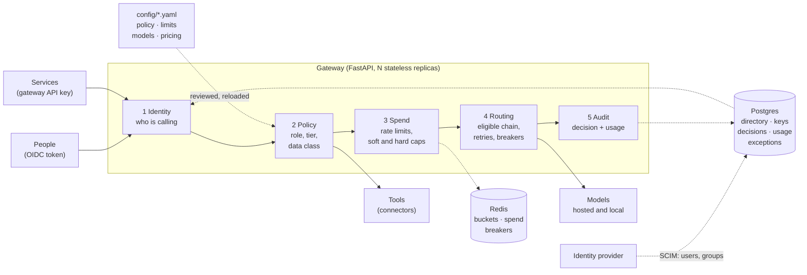
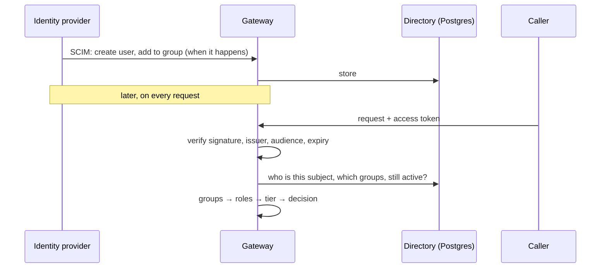

# Architecture

One gateway between the people and services that use AI and the models and tools they
use. Every request passes five stages, in this order:

**identity → policy → spend → routing → audit**

## The five stages

| Stage | Question | How | Code |
|-------|----------|-----|------|
| **1. Identity** | Who is calling? | A person presents an OIDC access token from the identity provider, verified against its published keys. A service presents a gateway API key, stored hashed. Both become one `Principal`: a subject, groups, roles and a tier. | `app/oidc.py`, `app/auth/`, `app/directory.py`, `app/scim.py` |
| **2. Policy** | May they do this, with this data? | `config/policy.yaml` maps group → role → tier, says which model may hold which class of data, and which role may call which tool. The request declares its data class in a header. | `app/access.py`, `config/policy.yaml` |
| **3. Spend** | Can they afford it? | Requests and tokens per minute, then an atomic hold against the monthly budget. A soft cap warns; the hard cap refuses, unless an approved exception raised it for this month. | `app/ratelimit/`, `app/metering.py`, `app/spend_exceptions.py` |
| **4. Routing** | Which model answers? | The alias's fallback chain, **already filtered** to the models allowed to hold this data, tried in order with retries and a circuit breaker per model. | `app/routing/`, `app/providers/` |
| **5. Audit** | What was decided, and what did it cost? | One decision record per request, allowed or denied, with the policy version. One usage row with tokens, cost and latency. Joined by request id. Never content. | `app/decisions.py`, `app/observability/` |

A tool call (`POST /v1/tools/{connector}/{tool}`) takes the same path, with a connector in
place of the router. The connector mints a short-lived credential only after the policy
allowed the call (`app/connectors.py`).

## Where the groups come from

The token proves who is calling and nothing else. Groups are read from the directory on
each request, so removing someone from a group or deactivating them takes effect on their
next request, not when their token expires
([ADR 0029](decisions/0029-identity-oidc-tokens-and-scim-directory.md)).

## Data classes and the fallback chain

A request declares `public`, `internal`, `confidential` or `restricted`. Each model has a
ceiling set from its provider's retention terms. Before routing, the chain is cut down to
the models at or above the request's class. Retries and fallback then work only inside
what is left, so there is no code path by which a confidential request reaches a model
that may not hold it. The response cache and judge sampling, which copy prompt content
elsewhere, follow the same ceiling ([ADR 0028](decisions/0028-access-policy-data-classes-and-decision-log.md)).

## State

| Store | Holds | If it is down |
|-------|-------|---------------|
| **Postgres** | Directory (users, groups), API keys (hashed), decision log, usage log, admin audit log, spend exceptions | Recently seen callers are served from cache; others get 503. Decisions and usage rows queue, then drop and are counted. No new spend exceptions; existing caps hold. |
| **Redis** | Rate-limit buckets, month-to-date spend, circuit breakers, alert de-duplication | Rate limits and breakers fail open. Budgets use the last known spend and queue what is spent. |
| **Config files** | Policy, limits, models, prices | Loaded at start and on reload. A file that fails validation is refused and the previous one stays live. |

Replicas hold no state of their own beyond short caches (keys and identities for 30
seconds, a refused caller's grants for 10, a GitHub installation token for under an hour).

## Trust boundaries

- **Callers** are untrusted until stage 1. Everything they send (headers, path segments,
  bodies) is validated and bounded before it reaches a log, a database or a URL.
- **The identity provider** is trusted for who someone is and which groups they are in.
  It reaches the gateway only through `/scim/v2` with its own bearer token.
- **Operators** use `/admin/*` with named operator keys. The production proxy keeps
  those paths off the public listener.
- **Models and tools** are outside. What they return is content, not instruction: tool
  results are scanned by the injection filter like user input.
- **Secrets** are environment variables or mounted files, never config or code. The
  gateway stores no provider token beyond memory, and its logs never hold prompts,
  answers, tool arguments or credentials.

## Going deeper

- [Decision records](decisions/) explain each choice, 0027–0032 for the governance layer.
- The [wiki](wiki/Home.md) covers each part: [identity](wiki/Identity.md),
  [governance](wiki/Governance.md), [connectors](wiki/Connectors.md),
  [limits and budgets](wiki/Keys-Limits-and-Budgets.md),
  [routing](wiki/Routing-and-Reliability.md), [model evals](wiki/Model-Evals.md) and the
  [component-level architecture](wiki/Architecture.md).
