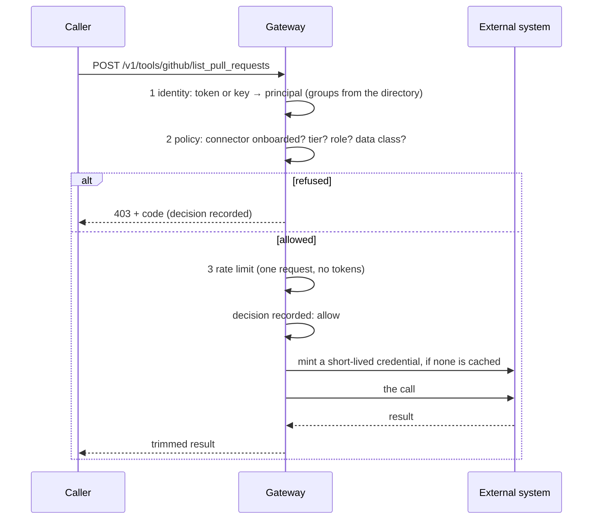

# Connectors: how tool calls are governed

*For engineers who build on the gateway or add a connector.*

## The shape

A connector exposes one external system as a few tools. There is exactly one way to
reach one:

```
POST /v1/tools/{connector}/{tool}      {"args": {...}}
Authorization: Bearer <OIDC token or gateway key>
x-gateway-data-class: internal          (optional; the policy's default applies)
```



## The policy check

```yaml
# config/policy.yaml
connectors:
  github:
    min_tier: standard
    max_data_class: internal     # the arguments leave for a third party
    allowed_roles: [engineer]    # empty = any role with the tier
```

`AccessPolicy.check_connector` (`app/access.py`) returns the first failure:

| Code | Check |
|------|-------|
| `connector_unknown` | No entry under `connectors:`. Registered code without a policy entry can't be called |
| `tier_unranked`, `tier_too_low` | The caller's tier against `min_tier` |
| `role_not_allowed` | The caller's roles against `allowed_roles` |
| `data_class_not_eligible` | The request's class against `max_data_class` |
| `tool_not_exposed` | The connector has no such tool |

The policy is loaded with a schema and cross-checked against the registry: a policy entry
for a connector that doesn't exist fails at load and in CI, not at request time.

**Why roles come from a directory, not the token:** a token is a snapshot from when it
was issued. Groups are read from the SCIM-provisioned directory on each request, so a
mover or leaver changes on their next call (ADR 0029).

**Why the data class is on the connector:** arguments are data too. A repository name
sent to a hosted service has left the building, so that connector is capped at
`internal`. A connector to an internal system of record can go to `restricted`.

## Credentials

The `Connector` protocol separates getting a credential from using it:

```python
class Connector(Protocol):
    name: str
    tools: frozenset[str]
    schemas: dict[str, dict[str, Any]]      # description + JSON Schema per tool

    async def credential(self) -> str: ...
    async def call(self, tool: str, args: dict[str, Any], credential: str) -> dict[str, Any]: ...
```

`credential()` runs only after the policy allowed the call. For GitHub (ADR 0031):

1. Sign a JWT with the app's private key: RS256, nine minutes, issuer = app id.
2. `POST /app/installations/{id}/access_tokens` with `{"permissions": {"pull_requests": "read"}}`:
   less than the app holds.
3. Keep the one-hour token in process memory until five minutes before it expires. One
   exchange at a time (a lock), however many calls are waiting.

Design points you may be asked about:

- **Not in Redis.** A shared store turns a credential into data other things can read.
  The cost is one exchange per replica per hour.
- **The key is a file, read at each exchange.** Rotation needs no restart, and the key
  never appears in an environment dump.
- **A 401 drops the cached token.** The next call exchanges again.
- **Acts as the app, not the user.** Every entitled caller sees what the app is installed
  on. Acting as the individual needs OAuth on their behalf and a token store per user.

## Arguments and results

- **Arguments are validated before they reach a URL.** `repo` must match `owner/name`;
  anything else is `400 invalid_tool_arguments` and nothing is sent. Without this, a
  caller could steer the gateway's token to another endpoint.
- **Results are trimmed** to the fields a caller needs, and long text is cut.
- **Results are third-party content.** A pull request description is written by whoever
  opened it. When a tool result goes to a model, the injection filter scans it as a tool
  result (ADR 0021).

## Errors

| Status | Code | Meaning |
|--------|------|---------|
| 400 | `invalid_tool_arguments` | The connector rejected the arguments; nothing was sent |
| 403 | (table above) | Policy |
| 429 | `rate_limit_exceeded` | The caller's request limit |
| 502 | `connector_error` | The external system failed or refused; the message is safe to show |
| 503 | `connector_not_configured` | The connector's settings are missing here |

Messages never include a credential, and exception text from the HTTP client is logged by
type only.

## What is logged

One decision record per call, allow or deny: subject, roles, tier, `tool:<connector>.<tool>`,
data class, code, policy version, request id. Never the arguments or the result. The
action is built from the path, so both segments are cut to 64 characters before they
reach the log.

## Offering tools to a model

`connectors.tool_definitions()` returns every registered tool as a function definition
(`github__list_pull_requests`). The eval harness offers them to both models and checks
the real tool calls, so a model change that starts calling a tool to add two numbers is
caught before it ships (ADR 0030).

## Add a connector

1. A class in `app/connectors.py` with `name`, `tools`, `schemas`, `credential()` and
   `call()`; register it in `REGISTRY`.
2. An entry under `connectors:` in `config/policy.yaml`; bump the policy version.
3. Tests, with the external HTTP mocked (`tests/test_github_connector.py` is the model):
   - the credential: claims, scope, caching, expiry, concurrent calls, failures;
   - each tool, including arguments that must never reach the external system;
   - through the gateway: an allowed role, a refused role, a refused data class.
4. A golden task in `evals/golden.yaml` if a model should (or shouldn't) reach for it.

## Tools the gateway doesn't run

A tool server can live outside the gateway and still be governed by it: it authenticates
the user, then asks `POST /v1/authorize` whether that user may use that tool with that
class of data. The policy entry is marked `external: true`. The user's token is never
forwarded; the gateway resolves the user from its own directory. See ADR 0033.

## Limits

- The data class is declared, not detected.
- One GitHub installation is configured; several organisations need one per owner.
- Read-only by design. A write tool would need an allow-list per tool and, for anything
  destructive, a confirmation step outside the model's control.
