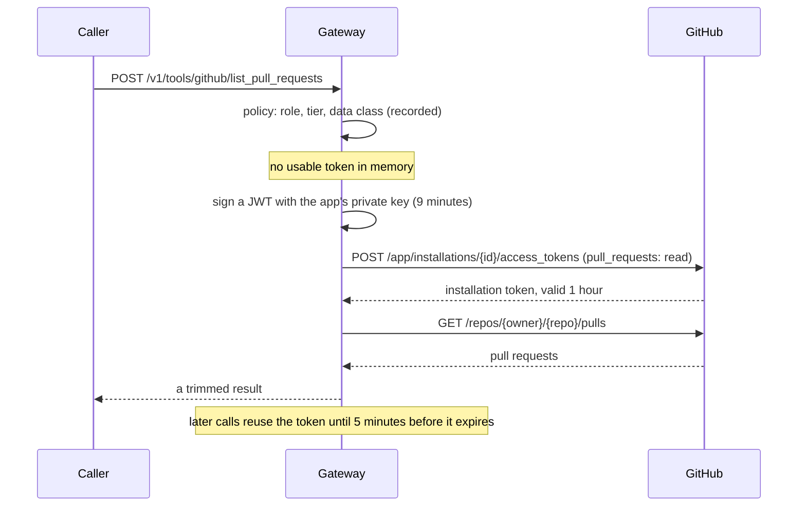

# Connectors

A connector exposes one external system as a few tools. Every call goes through
`POST /v1/tools/{connector}/{tool}`, behind the same policy as model calls
([Governance](Governance.md#tools)), and is in the decision log whether it was allowed or not.

| Connector | Tools | What it is |
|-----------|-------|------------|
| `mock_records` | `lookup_case` | A stand-in for a system of record, so the policy path can be shown without an account |
| `github` | `list_pull_requests`, `get_pull_request` | Pull requests, read-only, through a GitHub App |

## GitHub

```bash
curl localhost:8000/v1/tools/github/list_pull_requests -H "Authorization: Bearer $GW_KEY" \
  -H 'content-type: application/json' \
  -d '{"args":{"repo":"your-org/your-repo","state":"open","limit":10}}'

curl localhost:8000/v1/tools/github/get_pull_request -H "Authorization: Bearer $GW_KEY" \
  -H 'content-type: application/json' -d '{"args":{"repo":"your-org/your-repo","number":7}}'
```

The shipped policy allows it for the `engineer` role, at the `standard` tier, with data up
to `internal`: the arguments leave for GitHub, so nothing more sensitive may go with a call.

### How the credential works

No GitHub token is stored anywhere ([ADR 0031](../decisions/0031-github-app-credentials-for-connectors.md)).



- The app's **private key** is the only long-lived secret. It stays in a file.
- The **installation token** lives an hour, reaches only the repositories the app is
  installed on (plus public ones, like any GitHub token), and is requested with only
  `pull_requests: read`. It is kept in memory, never written anywhere and never returned.

### Create the GitHub App

1. Open `https://github.com/settings/apps/new` (for an organisation:
   `https://github.com/organizations/<org>/settings/apps/new`).
2. Fill in:
   - **GitHub App name:** anything unique.
   - **Homepage URL:** any URL (required, not used).
   - **Webhook → Active:** off. The gateway only reads.
   - **Repository permissions → Pull requests:** Read-only. Leave everything else at
     "No access" (Metadata: Read-only is selected for you).
   - **Where can this GitHub App be installed?** Only on this account.
3. **Create GitHub App.** Note the **App ID** on the next page.
4. Under **Private keys**, **Generate a private key**. A `.pem` file downloads.
5. **Install App** → your account → **Only select repositories** → choose them → **Install**.
   The page you land on ends in `/installations/<number>`: that is the **installation ID**.

### Configure the gateway

Keep the key outside the repository, readable only by you:

```bash
mkdir -p ~/.config/ai-gateway
mv ~/Downloads/<app-name>.*.private-key.pem ~/.config/ai-gateway/github-app.pem
chmod 600 ~/.config/ai-gateway/github-app.pem
```

In `.env`:

```bash
GITHUB_APP_ID=<app id>
GITHUB_APP_INSTALLATION_ID=<installation id>
GITHUB_APP_PRIVATE_KEY_FILE=/home/you/.config/ai-gateway/github-app.pem
```

`make up` mounts that file read-only into the container. Elsewhere, mount it as a secret
and set `GITHUB_APP_PRIVATE_KEY_FILE` to the path inside the container.
`GITHUB_API_URL` (default `https://api.github.com`) points at GitHub Enterprise Server.

### When it fails

| Response | Meaning |
|----------|---------|
| `403 role_not_allowed`, `tier_too_low`, `data_class_not_eligible` | Policy refused the call; nothing was sent to GitHub |
| `400 invalid_tool_arguments` | `repo` isn't `owner/name`, or another argument is out of range |
| `503 connector_not_configured` | One of the three settings is empty, or the key file is missing, unreadable or not a private key |
| `502 connector_error`: "refused the gateway's credentials" | Wrong app id or installation id, a key that was deleted on GitHub, or a clock more than a minute off |
| `502 connector_error`: "not found, or the gateway's app is not installed on that repo" | Install the app on the repository, or check the name |

**Rotate the key:** generate a new one on the app's page, replace the file, delete the old
key on GitHub. The gateway reads the file at the next exchange, within the hour; no restart.

## External tool servers

Some tools run outside the gateway: an MCP server that works in Jira and Confluence as
each user, with that user's own grant
([mcp-atlassian-governed](https://github.com/AndrewTtofi/mcp-atlassian-governed)). The
gateway doesn't call it. The server authenticates the user itself, then asks the gateway
for a decision on every tool call ([ADR 0033](../decisions/0033-decisions-for-external-tool-servers.md)):

```bash
curl localhost:8000/v1/authorize -H "Authorization: Bearer $SERVER_KEY" \
  -H 'content-type: application/json' \
  -d '{"subject":"<the user id from their token>","connector":"atlassian","tool":"jira_search"}'
# {"allowed":true,"code":"ok","reason":"ok","policy_version":"2026-10-13.1"}
```

```yaml
# config/policy.yaml
connectors:
  atlassian:
    external: true                 # no code in the gateway; it only decides
    min_tier: standard
    max_data_class: internal
    allowed_roles: [engineer, compliance, trader]
    tools: [jira_search, jira_get_issue, jira_add_comment]   # empty = any tool name

delegated_decisions:
  client_groups: [mcp-servers]     # the services that may ask; empty = nobody
```

- **The server's credential** is a gateway API key in one of those groups:
  `make key name=mcp-atlassian tier=standard team=mcp-servers`.
- **The user's token is never forwarded.** The server sends the token's subject; the
  gateway looks that user up in its directory, so a deactivated user is refused here too.
- **A refusal is `200` with `allowed: false`** and a code (`role_not_allowed`,
  `tier_too_low`, `data_class_not_eligible`, `tool_not_exposed`, `user_deactivated`, …).
- **The decision is recorded under the user's name,** with `asked_by` naming the server.
- **The server must fail closed** if the gateway doesn't answer.

## Add a connector

1. A class in `app/connectors.py` with `name`, `tools`, `schemas`, `credential()` and
   `call()`, registered in `REGISTRY`. `credential()` mints what a call needs; nothing
   long-lived goes in config.
2. An entry under `connectors:` in `config/policy.yaml`. Without one it can't be called.
3. Tests for the allowed call, the refused roles and data classes, and the external
   system's failures, with its HTTP calls mocked.
