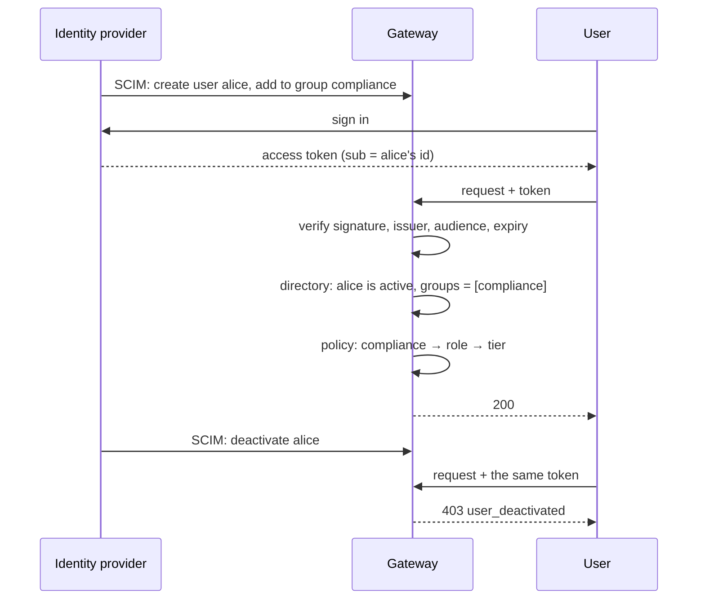

# Identity: OIDC tokens and SCIM provisioning

People call the gateway as themselves. The identity provider (IdP) does two things, both
standards, and the gateway needs nothing else from it:

| Standard | Direction | What it does |
|----------|-----------|--------------|
| **SCIM 2.0** | IdP → gateway | Pushes users, groups and memberships as they change |
| **OIDC** | user → gateway | An access token that says who is calling |

[ADR 0029](../decisions/0029-identity-oidc-tokens-and-scim-directory.md) has the reasoning.
Services and machines keep using [gateway API keys](Keys-Limits-and-Budgets.md).

## The rule: the token says who, the directory says what



Group claims in the token are ignored. Groups are read from the directory on every
request, so a change in the IdP takes effect on the next request, not when the token expires.

| What happens in the IdP | What the caller gets next |
|---|---|
| Added to a group | That group's role and tier |
| Removed from a group | The entitlement is gone (for example `403 role_not_allowed`) |
| Deactivated | `403 user_deactivated` |
| Deleted | `403 user_not_provisioned` |
| In no group the policy maps | `403 no_entitlement` |

Each of those denials is in the [decision log](Governance.md#the-decision-log), and every
provisioning change is in the admin audit log as operator `scim`.

A user's directory id is their identity for rate limits, the monthly budget and the usage
log, so all of one person's tokens count against one budget.

## Try it: authentik in the dev stack

[authentik](https://goauthentik.io) is an open-source IdP that speaks both standards. It
runs in the compose stack, so there is no account to create and no tunnel.

```bash
# .env: SCIM_TOKEN, GATEWAY_OIDC_CLIENT_SECRET, AUTHENTIK_SECRET_KEY,
#       AUTHENTIK_BOOTSTRAP_PASSWORD, AUTHENTIK_BOOTSTRAP_TOKEN  (openssl rand -hex 32 each)
make idp        # the dev stack plus authentik on http://localhost:9000 (first boot: ~2 min)
make idp-e2e    # join, move, leave, in a throwaway stack
```

`config/authentik/blueprints/ai-gateway.yaml` configures authentik as code: an OIDC
provider that signs RS256 tokens for the gateway, a SCIM provider pointed at
`http://gateway:8000/scim/v2`, and the application that joins them.

Sign in at `http://localhost:9000` as `akadmin` with `AUTHENTIK_BOOTSTRAP_PASSWORD`, then:

1. **Directory → Groups:** create `compliance` (a group `config/policy.yaml` maps to a role).
2. **Directory → Users:** create a user and add them to the group. Within a few seconds the
   gateway has them: `curl -s localhost:8000/scim/v2/Users -H "Authorization: Bearer $SCIM_TOKEN"`.
3. **Get a token.** For a script, create an app password for the user (**Directory → Tokens
   and App passwords**, intent *App password*) and exchange it:

```bash
TOKEN=$(curl -s http://localhost:9000/application/o/token/ \
  -d grant_type=client_credentials -d client_id=ai-gateway \
  -d username=alice --data-urlencode "password=$APP_PASSWORD" -d 'scope=openid profile' \
  | python3 -c 'import json,sys; print(json.load(sys.stdin)["access_token"])')

curl -s localhost:8000/v1/tools/mock_records/lookup_case -H "Authorization: Bearer $TOKEN" \
  -H 'content-type: application/json' -d '{"args":{"case_id":"C-1001"}}'
```

4. Remove the user from the group, or deactivate them, and run the last command again.

`scripts/identity_e2e.sh` does exactly this through authentik's API and checks the answers,
the decision log and the audit trail. CI runs it on every pull request.

## Using another identity provider

Nothing in the gateway is specific to authentik.

| Setting | Meaning |
|---------|---------|
| `OIDC_ISSUER` | Exactly the tokens' `iss` |
| `OIDC_AUDIENCE` | A value the tokens' `aud` must contain |
| `OIDC_JWKS_URL` | Optional. Default: `jwks_uri` from `<issuer>/.well-known/openid-configuration` |
| `OIDC_USER_CLAIM` | The claim that names the user (default `sub`) |
| `OIDC_USER_MATCH` | The directory attribute it matches: `external_id` (default) or `user_name` |
| `SCIM_TOKEN` | The bearer token the IdP presents to `/scim/v2`. Empty: SCIM is off |

In the IdP, create a SCIM 2.0 provisioning integration with base URL
`https://<gateway>/scim/v2` and bearer-token authentication, and an OIDC application or
authorization server whose access tokens are signed JWTs.

- **The join.** A token is matched to a provisioned user by `OIDC_USER_CLAIM` against
  `OIDC_USER_MATCH`. Check what your IdP puts in `sub` and what it sends as `externalId`.
  In Okta's default setup the access token's `sub` is the user's login and `uid` is their
  id, so either use `OIDC_USER_CLAIM=uid`, or match `sub` against `user_name`.
- **Reaching a laptop.** A hosted IdP can't call `localhost`. Expose the gateway while you
  test: `cloudflared tunnel --url http://localhost:8000`, and use the URL it prints as the
  SCIM base URL.
- **Signatures.** Only asymmetric algorithms are accepted (RS256, ES256 and relatives). A
  provider configured to sign with a shared secret (HS256) is refused.

## The SCIM server

`/scim/v2`, RFC 7643 and 7644, the subset providers call:

| Resource | Supported |
|----------|-----------|
| `Users` | create, read, list (`filter=userName eq "…"` or `externalId eq "…"`, `startIndex`, `count`), `PUT`, `PATCH`, delete |
| `Groups` | create, read, list (`filter=displayName eq "…"`), `PUT`, `PATCH`, delete |
| `ServiceProviderConfig`, `ResourceTypes` | read |

Stored per user: `userName`, `externalId`, `active`, a display name and the primary email.
Other attributes are accepted and ignored. Group names are unique, because the policy maps
them.

`PATCH` accepts the forms providers differ on:

```json
{"op": "remove", "path": "members[value eq \"<id>\"]"}
{"op": "remove", "path": "members", "value": [{"value": "<id>"}]}
{"op": "Replace", "path": "active", "value": "False"}
{"op": "replace", "value": {"active": false}}
```

- Errors use the SCIM error schema, with `scimType` (`uniqueness`, `invalidFilter`, …).
- A filter the server doesn't support is a `400 invalidFilter`. Ignoring it would answer
  "everyone matches".
- A member id the directory doesn't know is skipped. It grants nothing, and a group push
  doesn't fail on it.

## Failure behaviour

| Situation | Answer |
|-----------|--------|
| Bad signature, wrong issuer or audience, expired, symmetric or `none` algorithm | `401 invalid_token` |
| The IdP's keys can't be fetched and none are cached | `503 auth_unavailable` |
| The IdP is down but its keys are cached | Tokens keep verifying |
| The directory (Postgres) can't be read | `503 auth_unavailable` |
| An unknown key id | One refetch of the keys, at most once a minute |

Not covered: tokens are not checked for revocation at the IdP on each request.
Deactivating the user is the control; keep token lifetimes short.
